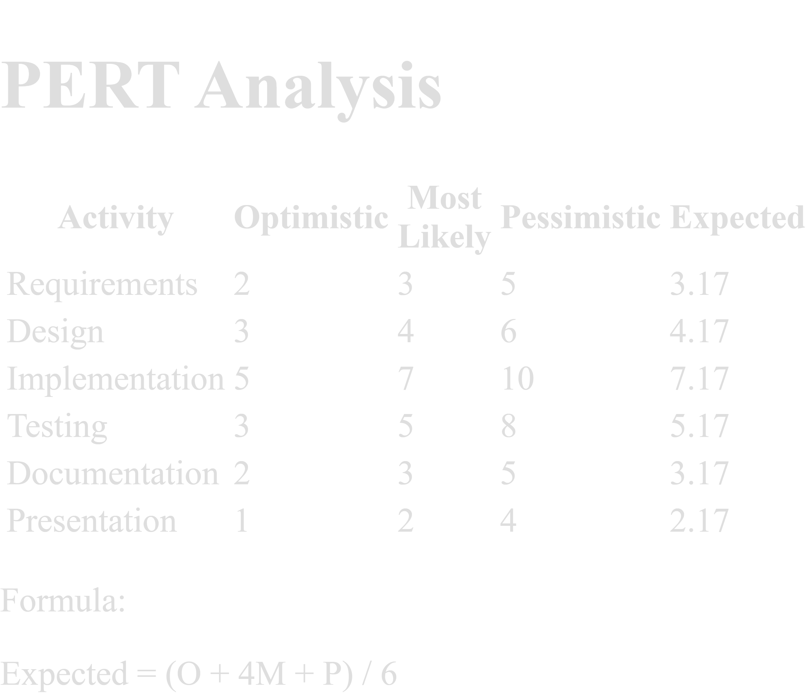

PERT Analysis
Activity	Optimistic	Most Likely	Pessimistic	Expected
Requirements	2	3	5	3.17
Design	3	4	6	4.17
Implementation	5	7	10	7.17
Testing	3	5	8	5.17
Documentation	2	3	5	3.17
Presentation	1	2	4	2.17
Formula:

Expected = (O + 4M + P) / 6

